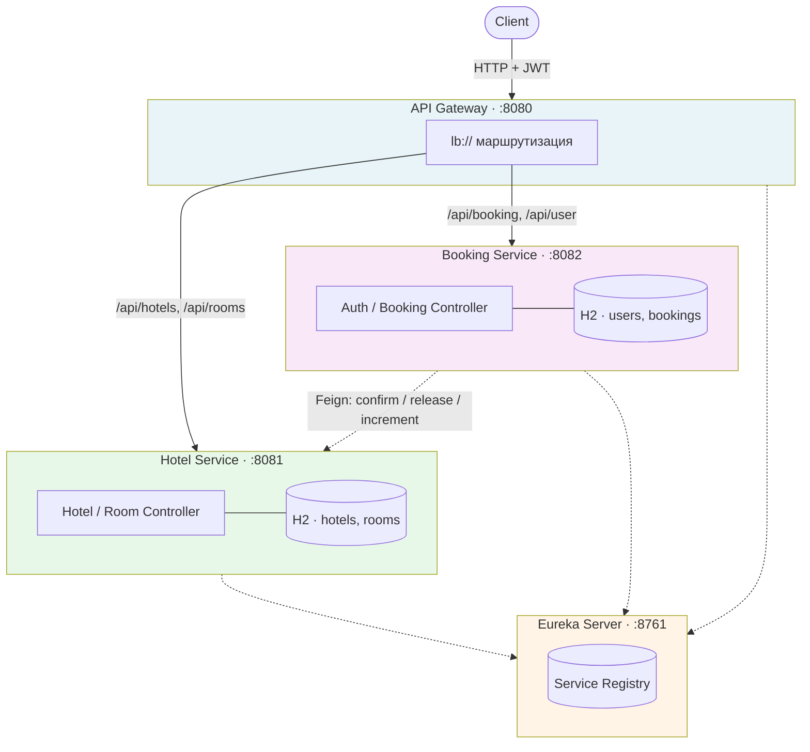

# 🏨 Система бронирования отелей

Микросервисная система бронирования отелей на **Spring Boot 3.5.6**, **Spring Cloud 2025.0**, **Java 21**.


> Итоговый проект по дисциплине «Фреймворк Spring и работа с REST API».  
> НИЯУ МИФИ ИИКС РПО, 2 курс, 3 семестр (2026–2027).
> Студент: Лаврентьев Антон

---

## 📖 О проекте

REST API для управления отелями, номерами и бронированиями, построенное по принципам микросервисной архитектуры:

- **Eureka Server** — динамическое обнаружение сервисов;
- **API Gateway** — единая точка входа, маршрутизация, проксирование JWT;
- **Hotel Service** — CRUD отелей и номеров, статистика загруженности;
- **Booking Service** — регистрация/авторизация, управление бронированиями, сага с компенсацией.

Аутентификация и авторизация — JWT с ролями `USER` и `ADMIN`. Каждый сервис валидирует токен самостоятельно (Resource Server).

Согласованность данных между сервисами реализована через **сагу с компенсацией**: бронирование создаётся в статусе `PENDING`, подтверждение доступности номера запрашивается у Hotel Service, при успехе — `CONFIRMED`, при ошибке — `CANCELLED` с откатом блокировки.

---

## 🏗 Архитектура



### Как читать схему

| Компонент | Порт | Назначение |
|---|---|---|
| **api-gateway** | `8080` | Единая точка входа. Маршрутизирует запросы через `lb://` (Eureka discovery). JWT не валидирует — это делают сервисы. |
| **eureka-server** | `8761` | Реестр сервисов. Все остальные регистрируются в нём и находят друг друга по имени. |
| **hotel-service** | `8081` | Отели и номера. Хранит `times_booked` и слоты. Принимает внутренние вызовы от Booking Service. |
| **booking-service** | `8082` | Пользователи, брони, JWT. Оркестрирует сагу. |

Стрелка `Booking → Hotel` (пунктир) — синхронный Feign-вызов с retry и timeout, это ключевая часть саги.

---

## 🛠 Технологический стек

| Слой | Технология |
|---|---|
| Язык | Java 21 (Temurin) |
| Фреймворк | Spring Boot 3.5.6 |
| Микросервисы | Spring Cloud 2025.0 (Northfields) |
| Service Discovery | Netflix Eureka |
| API Gateway | Spring Cloud Gateway |
| Межсервисные вызовы | Spring Cloud OpenFeign |
| Устойчивость | Spring Retry (`@Retryable`), Feign timeouts |
| Безопасность | Spring Security, OAuth2 Resource Server, JJWT 0.12 |
| Персистентность | Spring Data JPA + H2 (in-memory) |
| Валидация | Jakarta Bean Validation |
| Документация API | — (см. *Известные ограничения*) |
| Сборка | Maven (Maven Wrapper) |

---

## 📂 Структура репозитория

```
BookingCore/
├── eureka-server/         # Service Registry
├── hotel-service/         # Отели и номера
├── booking-service/       # Пользователи и бронирования
├── api-gateway/           # Единая точка входа
└── README.md
```

Каждый модуль — самостоятельный Spring Boot проект с собственным `pom.xml` и in-memory H2.

---

## 🚀 Быстрый старт

### Предусловия

- **JDK 21** (`java -version` должен показать `21.x`)
- **Maven** — не нужен отдельно, используется встроенный `./mvnw`
- Свободные порты: `8080`, `8081`, `8082`, `8761`

### Сборка

```bash
# из корня репозитория
for module in eureka-server hotel-service booking-service api-gateway; do
  (cd "$module" && ./mvnw clean package -DskipTests) || echo "FAILED: $module"
done
```

### Запуск (порядок важен!)

Откройте **четыре терминала** в корне `BookingCore`:

```bash
# Терминал 1 — Eureka (запускать первым)
cd eureka-server && ./mvnw spring-boot:run

# Терминал 2 — Hotel Service (после старта Eureka)
cd hotel-service && ./mvnw spring-boot:run

# Терминал 3 — Booking Service
cd booking-service && ./mvnw spring-boot:run

# Терминал 4 — API Gateway (последним)
cd api-gateway && ./mvnw spring-boot:run
```

### Проверка запуска

1. **Eureka UI** — откройте http://localhost:8761  
   В разделе *Instances currently registered* должны быть `HOTEL-SERVICE`, `BOOKING-SERVICE`, `API-GATEWAY`.
2. **Gateway health**:
   ```bash
   curl http://localhost:8080/actuator/health
   # {"status":"UP"}
   ```
3. **H2 консоли** (для отладки):
    - Hotel Service: http://localhost:8081/h2-console (`jdbc:h2:mem:hotel`)
    - Booking Service: http://localhost:8082/h2-console (`jdbc:h2:mem:booking`)

### Предзаполненные данные

При первом запуске `BootstrapConfig` автоматически создаёт:

| Что | Значения |
|---|---|
| **Админ** | логин `admin`, пароль `admin` |
| **Тестовый пользователь** | логин `testuser`, пароль `testpass` |
| **Отели** | «Grand Hotel» (Москва), «Cozy Inn» (СПб) |
| **Номера** | 101–105 в Grand Hotel, 201–203 в Cozy Inn |

Переопределить админа можно через переменные окружения:
```bash
export BOOTSTRAP_ADMIN_USER=custom_admin
export BOOTSTRAP_ADMIN_PASS=strong_password
```

---

## 📡 Эндпойнты

Все публичные запросы идут **через Gateway на `http://localhost:8080`**.  
Внутренние эндпойнты Hotel Service (`confirm-availability`, `release`, `increment-bookings`) не публикуются через Gateway — только для Feign-вызовов.

### 🔐 Аутентификация (Booking Service)

| Метод | Путь | Доступ | Описание |
|---|---|---|---|
| `POST` | `/api/user/register` | public | Регистрация + выдача JWT |
| `POST` | `/api/user/auth` | public | Авторизация + выдача JWT |

### 📅 Бронирования (Booking Service)

| Метод | Путь | Доступ | Описание |
|---|---|---|---|
| `POST` | `/api/booking` | USER | Создать бронирование |
| `GET` | `/api/booking` | USER | Мои бронирования |
| `GET` | `/api/booking/{id}` | USER | Бронирование по id (только своё) |
| `DELETE` | `/api/booking/{id}` | USER | Отменить бронирование |

### 🏨 Отели и номера (Hotel Service)

| Метод | Путь | Доступ | Описание |
|---|---|---|---|
| `GET` | `/api/hotels` | USER | Все отели |
| `GET` | `/api/hotels/{id}` | USER | Отель по id |
| `POST` | `/api/hotels` | ADMIN | Создать отель |
| `GET` | `/api/rooms` | USER | Все свободные номера |
| `GET` | `/api/rooms/recommend` | USER | Номера, отсортированные по `times_booked` ↑, `id` ↑ |
| `POST` | `/api/rooms` | ADMIN | Создать номер |

### 🔒 Внутренние (Hotel Service, не через Gateway)

| Метод | Путь | Описание |
|---|---|---|
| `POST` | `/api/rooms/{id}/confirm-availability` | Временная блокировка слота |
| `POST` | `/api/rooms/{id}/release` | Компенсация: снять блокировку |
| `POST` | `/api/rooms/{id}/increment-bookings` | Инкремент `times_booked` |

---

## 🧪 Примеры использования

### 1. Регистрация и получение токена

```bash
curl -X POST http://localhost:8080/api/user/register \
  -H "Content-Type: application/json" \
  -d '{"username":"alice","password":"secret123"}'
```

Ответ:
```json
{"token":"eyJhbGciOiJIUzI1NiJ9...","type":"Bearer"}
```

Сохраните токен:
```bash
TOKEN="eyJhbGciOiJIUzI1NiJ9..."
```

### 2. Просмотр отелей и рекомендованных номеров

```bash
curl -H "Authorization: Bearer $TOKEN" http://localhost:8080/api/hotels

curl -H "Authorization: Bearer $TOKEN" http://localhost:8080/api/rooms/recommend
# [{"id":1,"hotelId":1,"number":"101","available":true,"timesBooked":0}, ...]
```

### 3. Создание бронирования

```bash
curl -X POST http://localhost:8080/api/booking \
  -H "Authorization: Bearer $TOKEN" \
  -H "Content-Type: application/json" \
  -d '{
    "roomId": 1,
    "startDate": "2026-12-01",
    "endDate": "2026-12-05"
  }'
```

Ответ (при успехе) — бронь в статусе `CONFIRMED`. Если Hotel Service недоступен или номер занят — `CANCELLED` (в логах будет виден результат компенсации).

### 4. История и отмена

```bash
curl -H "Authorization: Bearer $TOKEN" http://localhost:8080/api/booking
curl -X DELETE -H "Authorization: Bearer $TOKEN" http://localhost:8080/api/booking/1
```

### 5. Администраторские операции

```bash
# Получаем токен админа
ADMIN_TOKEN=$(curl -s -X POST http://localhost:8080/api/user/auth \
  -H "Content-Type: application/json" \
  -d '{"username":"admin","password":"admin"}' | jq -r .token)

# Создать отель
curl -X POST http://localhost:8080/api/hotels \
  -H "Authorization: Bearer $ADMIN_TOKEN" \
  -H "Content-Type: application/json" \
  -d '{"name":"Ritz","address":"Москва, Тверская 1"}'

# Создать номер
curl -X POST http://localhost:8080/api/rooms \
  -H "Authorization: Bearer $ADMIN_TOKEN" \
  -H "Content-Type: application/json" \
  -d '{"hotelId":1,"number":"999"}'
```

---

## 🔐 Безопасность

- **JWT** — срок действия **1 час** (`security.jwt.ttl-seconds: 3600`), подпись HS256.
- **Роли**:
    - `USER` — только личные операции (свои брони, просмотр отелей/номеров);
    - `ADMIN` — CRUD отелей и номеров, доступ к админ-эндпойнтам.
- **Resource Server** — каждый сервис валидирует токен самостоятельно через `NimbusJwtDecoder` (общий секрет в `application.yml`).
- **Методная безопасность** — `@PreAuthorize("hasRole('ROLE_USER')")` и `@PreAuthorize("hasRole('ROLE_ADMIN')")`.
- **CSRF** — отключён (stateless API).

⚠️ **Для production**: секрет JWT вынести в переменную окружения `SECURITY_JWT_SECRET`, включить HTTPS, добавить refresh-токены.

---

## 🧪 Тестирование

```bash
# Booking Service
cd booking-service && ./mvnw test

# Hotel Service
cd hotel-service && ./mvnw test
```

Тесты используют:

- **JUnit 5** + **TestRestTemplate** (интеграционные, `@SpringBootTest(webEnvironment = RANDOM_PORT)`);
- **H2** in-memory (`application-test.yml`);
- **Eureka отключена** в тестах (`eureka.client.enabled=false`).

Покрытые сценарии: успешная аутентификация, отказ при отсутствии токена (401), отказ при недостаточной роли (403), идемпотентность внутренних эндпойнтов (`X-Request-Id`).

---

## 📋 Ключевые проектные решения (ADR)

### ADR-1. Сага с компенсацией вместо 2PC

**Контекст.** Бронирование затрагивает две БД (Booking и Hotel), глобальные распределённые транзакции не используются.

**Решение.** Двухшаговая сага:
1. Booking Service создаёт бронь в статусе `PENDING` (локальная транзакция).
2. Вызывает `POST /api/rooms/{id}/confirm-availability` в Hotel Service (Feign + retry).
3. При успехе — `CONFIRMED` + `increment-bookings`; при ошибке — `CANCELLED` + компенсация `release`.

**Альтернативы.** 2PC (XA) — отвергнут из-за сложности и требований к БД. Event-driven (Kafka) — избыточно для учебного проекта.

**Последствия.** Возможны промежуточные состояния (`PENDING`) при падении сервиса — это ожидаемо и решается регламентом реконсиляции (вне рамок проекта).

### ADR-2. JWT валидируется в каждом сервисе, а не только в Gateway

**Контекст.** Gateway мог бы выполнять всю проверку токена, снимая нагрузку с сервисов.

**Решение.** Gateway только маршрутизирует, каждый сервис — Resource Server.

**Обоснование.** Защита в глубину: даже если Gateway обойдут (внутренний вызов, ошибка конфигурации), сервис всё равно отклонит запрос без валидного JWT.

### ADR-3. In-memory H2 вместо внешней БД

По ТЗ — H2 in-memory. Каждый сервис имеет собственную БД (database-per-service). Данные теряются при перезапуске — для демо это приемлемо.

---

## 🗺 Roadmap

Если продолжать проект:

1. Реализовать `autoSelect` через `/api/rooms/recommend`.
2. Добавить проверку пересечения дат в `confirmAvailability` + возврат `409 Conflict`.
3. Перенести `@Retryable`-методы в отдельный бин (или сделать `public`).
4. Заменить `RuntimeException` на доменные исключения (`BadCredentialsException`, `AccessDeniedException`) → корректные `401/403`.
5. Подключить **springdoc-openapi-starter-webmvc-ui** (`/swagger-ui.html`).
6. Добавить **WireMock** для тестов Feign (успех / timeout / error / повторная доставка).
7. CircuitBreaker (Resilience4j) для вызовов Hotel Service.

---

## 🧹 Устранение неполадок

| Симптом | Причина | Решение |
|---|---|---|
| `release version 21 not supported` | Maven запущен на JDK < 21 | `sdk install java 21.0.5-tem && sdk use java 21.0.5-tem` |
| `curl: (56) ... 400` при `init.sh` | Скрипт устарел (Boot 3.5.6 EOL) | Не запускать, файл удалён из репозитория |
| Сервисы не видны в Eureka | Запущены до Eureka Server | Перезапустить Eureka → сервисы |
| `401 Unauthorized` | Токен просрочен или не передан | Получить новый через `/api/user/auth` |
| Порт занят | Остался процесс от предыдущего запуска | `lsof -i :8080` → `kill -9 <PID>` |

---

## 📄 Лицензия

Учебный проект. Распространяется под лицензией **MIT** — используйте свободно в учебных целях.
